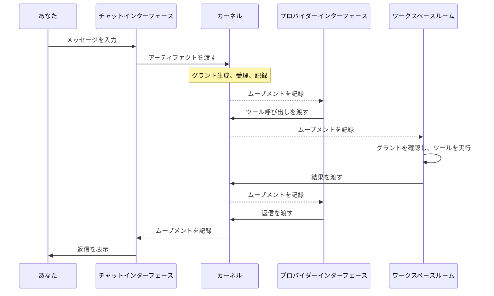

<p align="center">
  
</p>

<h1 align="center">Octopus Superintelligence OS</h1>

<p align="center">
  <b>長期的な自律稼働のための、実験的な自己進化型エージェント OS。</b><br>
  オペレーティングシステムの原則に基づいて構築され、エージェントが自らの環境を再構築し、自身の仕事の軌道を舵取りします。
</p>

<p align="center">
  <a href="https://github.com/miuuyy/Octopus-SI-OS/actions/workflows/quality.yml?query=branch%3Amain"></a>
  
  
  
  <a href="LICENSE"></a>
</p>

<p align="center">
  <a href="README.md">English</a> · <a href="README.zh-CN.md">简体中文</a> · <b>日本語</b>
</p>


Octopus は、持続的なエージェント作業のためのオペレーティングシステムです。目標、権限、ラン（run）、ツール、コンテキスト、外部イベントは、モデルループ内部に保持される状態ではなく、明示的で永続的なレコードとして扱われます。小さな Rust カーネルがグラント（grant）を生成し、アーティファクトの移動（movement）を受理して、追記専用台帳（ledger）に記録します。プロバイダー、チャネル、センサー、ツールルームは、レジストリが所有するインターフェースを通じて接続されます。

macOS クライアントはこれらを Home、Projects、Agents、Tasks に統合します。テキストや音声で対話し、ファイル、ブラウザ、デスクトップアプリ、連携サービス用のツール権限を付与できます。Home はデフォルトで Antigravity 経由の Gemini 4 Neon を使用し、Codex は初回サインイン、ライブ音声通話、音声入力を支えます。ChatGPT、Claude、Gemini、Vertex、API キープロバイダーもすべて同じ仕組みで接続されます。モデルとツールは宣言されたコントラクトを通じて動作し、どちらもランタイムの権限主体ではありません。

**自己進化（Self-evolution）** とは、将来の仕事の条件そのものを形づくることを意味します。ポリシーのもとで、エージェントは目標を作成・修正し、インターフェース（トリガー）を変更し、ツールを追加し、ワーカーを編成し、コンテキストや実行環境を整えることができます。これらの変更はタスクやランをまたいで永続化し、何に気づき、いつ行動し、何に取り組み、次にどの能力を使えるかに影響します。エージェントが自身の環境を変え、その環境がその後の振る舞いを形づくることで、単発のターンにとどまらず、長期にわたる作業の中でシステム自身が発展・改善していくことができます。

> [!NOTE]
> これはリサーチプレビューです。標準的なベンチマークや通常のコーディング作業においては、Octopus は Codex CLI のような通常のエージェントループ以上のものを提供しません。本作は、エージェントが数時間から数日にわたって自らの目標、トリガー、ランを組み立てる**長期かつオープンエンドな自律稼働**のために構築されています。これまでの無人実行では、ChatGPT や Claude のモデルは人間からの指示を待ち、自律的なイニシアチブを維持できませんでした。真の自律的なイニシアチブは、これまでのところ主に最近の **Gemini 4** モデル、特に **Gemini 4 Neon** に現れています。ランタイム自体はプロバイダー非依存を保ちつつ、現在の実験はそこに焦点を当てており、進行中の実行結果や素の Codex との比較は [@miu21590 on X](https://x.com/miu21590) で共有しています。

## 提供される機能

<table>
<tr><td><b>Home（ホーム）</b></td><td>システムとのひとつの連続した会話。入力でも音声でも話せます。作業中に画面上へライブウィジェットを表示することもできます。</td></tr>
<tr><td><b>Projects（プロジェクト）</b></td><td>独自のコンテキストと権限を持つ目標。あるプロジェクトでエージェントに許可されていることは、別のプロジェクトには一切影響しません。</td></tr>
<tr><td><b>Agents（エージェント）</b></td><td>一度設定すれば繰り返し使えます（モデル、役割、触れてよい範囲）。内部ではエージェントはプログラムではなく 2 つの JSON ファイルなので、いくつでも実行できます。</td></tr>
<tr><td><b>Tasks（タスク）</b></td><td>エージェントに渡すひとつの仕事。動かしたままにしておき、あとで戻って止まったところから再開できます。</td></tr>
<tr><td><b>ターミナルクライアント</b></td><td>ターミナル上でチャット、タスク、ツール、ファイル、結果を利用できます。デスクトップクライアントと同じ Home、Projects、Agents を共有します。</td></tr>
<tr><td><b>Applications（アプリケーション）</b></td><td>外部世界との接続：チャットチャネル、MCP サーバー、その他のモデルプロバイダー。</td></tr>
<tr><td><b>Drivers（ドライバー）</b></td><td>作業が物理的に行われる場所：フォルダ、git worktree、ブラウザ、デスクトップ、コンテナ、リモートマシン。</td></tr>
</table>

## はじめに

以下の手順でソースからビルドするか、[GitHub Releases](https://github.com/miuuyy/Octopus-SI-OS/releases) で公開されている Apple Silicon 向けディスクイメージを確認してください。インストーラー、動作要件、アドホック署名 / Gatekeeper の警告については[スタートガイド](docs/getting-started.md)を参照してください。バイナリが公開されていない場合はソースビルドを使用してください。

macOS 14+、Swift 6.2+（Xcode 26 または Command Line Tools）、Node 24、安定版 Rust、および ChatGPT アカウント（Home でデフォルトの Gemini 4 Neon モデルを使う場合は Antigravity も必要）が必要です。アカウントがなくても、読み取り専用の **Test** プロファイルでクライアントを試すことができ（[クライアントガイド](docs/client.md)）、追加プロバイダー（Gemini、Vertex、Claude Code、API キーや OpenAI 互換エンドポイント）は **Applications** で設定できます。

```sh
git clone https://github.com/miuuyy/Octopus-SI-OS.git
cd Octopus-SI-OS
npm ci --prefix app
```

次にアプリをパッケージ化して起動し、ChatGPT でサインインします。組み込みターミナルで Enter を押してシステムを起動し、与えたい機能を選んで、何か話しかけてみてください。

<details>
<summary><b>アプリをステップごとにパッケージ化する</b></summary>

<br>

ネイティブビルドには、npm を実行している Node のバージョンとは無関係に、固定された Electron 内部の Node バージョンのヘッダーが必要です。ランタイムヘルパーが `app/native/runtime.json` に固定されたヘッダーをダウンロード・検証し、そのパスを出力します。パッケージ化してアプリを起動します：

```sh
headers="$(node app/native/runtime.cjs headers)" &&
OCTOPUS_NATIVE_NODE_HEADERS="$headers" npm --prefix app run package:mac &&
open -n ./app/build/Octopus.app
```

パッケージ化では、クライアント、リリース版ランタイム、ケイパビリティ実行ファイル、プロバイダーブリッジがビルドされ、管理対象の Codex 配布物がバンドルされます。成果物は `app/build/Octopus.app` として出力され、このマシン向けにアドホック署名されます。公証（notarization）はされていないため、Gatekeeper が警告を表示する場合があります。

すでにこのチェックアウトから Octopus を起動中ですか？稼働中のバンドルをその場で再ビルドしないでください。[段階的なセルフアップデート手順](docs/development.md#updating-an-installation-that-runs-from-the-checkout)を使用してください。

</details>

<details>
<summary><b>初回起動</b></summary>

<br>

1. **ChatGPT でサインインします。** ブラウザが開きます。ターミナル上でのログインはありません。
2. **ローカルパスワードを設定します。** このマシン上のクライアントを保護します。
3. **システムを起動します。** 組み込みターミナルに `octopus up` で終わるコマンドが用意されます。Enter を押し、準備完了状態になるまで待ちます。
4. **初期構成を選びます。** プロジェクト、名前、Home のプロバイダーとモデル（デフォルトは Antigravity の Gemini 4 Neon）、およびケイパビリティを選び、**Set up Octopus** を選択します。
5. **Home で何か話しかけます。** 返信があれば接続が確認できます。ツールを使うタスクを実行すれば、そのタスクの設定が確認できます。

新しいタスクを始めるには、まず Agent を作成します。Project とモデルを選び、ケイパビリティを確認してから、タスク入力欄でその Agent を選択してください。

モデルの利用可否や使用制限はお使いのプロバイダーアカウントに依存します。音声機能や一部のアプリケーションでは、それぞれの認証情報と macOS の権限が求められます。

</details>

<details>
<summary><b>セットアップファイルから始める</b></summary>

<br>

セットアップファイル（`*.octopus-setup.json`）には Octopus のスペース、プロジェクト、ケイパビリティ、モデルが含まれますが、鍵、アカウント、履歴は一切含まれません。セットアップの最初のステップで **Import setup…** を選ぶとウィザードに読み込まれます。確認ステップの **Export setup…**、または **Settings → General → Setup file** から自分の構成を保存できます。[Legacy watch セットアップファイル](registry/interface/world_legacy_watch/legacy-watch.octopus-setup.json)で試してみてください。詳細は[セットアップファイル](docs/getting-started.md#setup-files)を参照してください。

</details>

ターミナルクライアントを使うには、チェックアウトからビルドして Octopus を開きます：

```sh
npm --prefix app run build:cli
./octopus
```

セットアップ、キーボード操作、既存 Home の選択、スクリプトや他エージェント向けコマンドについては[ターミナルクライアント](docs/cli.md)を参照してください。

## 仕組み

全体像は 2 つの言葉で表せます。**システム（System）** は Octopus が働きかけられるすべて。**世界（World）** はそれ以外のすべてです。両者は宣言されたインターフェースだけで出会い、それ以外の経路はありません。

内部には少数のプリミティブだけがあり、オーケストレーターは存在しません：

- **インターフェース（Interface）** — レジストリのフォルダで識別される型付きポート。プロバイダー、チャネル、センサー、ツールルーム、ワーカーはすべてインターフェースであり、それぞれのパッケージが実装を所有します。
- **アーティファクト（Artifact）** — 境界を越えられる唯一のもの。メッセージ、差分（diff）、ツール呼び出し、記憶など。
- **ラン（Run）** — アーティファクトの到着で待機と再開を繰り返す永続的な実行レコード。プロセスではなくデータです。
- **実行環境（EE：Execution environment）** — 目標によって分類されたポリシースコープ。ランは EE の中で生き、入れ子の環境は権限を狭めることしかできません。
- **ワーカー（Worker）** — いわゆるエージェント。ここではプログラムではなく記述であり、役割と決して越えられない権限上限を定義します。
- **ワーカー環境（Worker environment）** — ツールが物理的に作用するルーム。
- **グラント（Grant）** — 実際に有効な権限。到着のたびに、ワーカー上限・EE チェーン・ランのバインディングの積集合として生成されます。ポリシー入力は保存され、グラントはモデルの外側で再計算・強制されます。
- **ムーブメント台帳（Movement ledger）** — 拒否（refusal）も含め、境界越えを記録する追記専用ログ。プロジェクションやインデックスは再構築可能なビューであり、真実の情報源ではありません。
- **マーク（Mark）** — 何かが起きたことの証明。ベリファイア（verifier）が通過した後にのみ記録されます。

<details>
<summary><b>1 ターンのエンドツーエンドの流れ</b></summary>

<br>

Home にメッセージを入力し、Octopus がファイルを読んで返答するまでの流れです。



カーネルは何もプッシュせず、ペイロードをデコードすることもありません。各インターフェースは自分宛てのムーブメントを読み取る常駐プロセスです。プロバイダーインターフェースがモデルに見せる内容を組み立て、ルームのドアがグラントに照らしてツールを確認し実行します。モデルがツールを要求し続ける限りターンは継続し、返信を返した時点で終了します。

すべての「ムーブメントを記録」は台帳の 1 行です。拒否も同様に型付きの 1 行として記録され、黙って捨てられることはありません。

</details>

## 拡張する

すべて同じ方法で接続します。JSON を入れたフォルダと、実行が必要な場合のスクリプトまたはバイナリだけです。カーネルには一切触れません。

| やりたいこと | 追加するもの |
| --- | --- |
| 既存プロトコル上のプロバイダー | インターフェースフォルダ 1 つ |
| チャネルまたはセンサー | インターフェースフォルダ 1 つ。待ち受けが必要なら任意の言語のプロセスを追加 |
| ワーカー（エージェント） | `system_worker_<name>/` フォルダ：JSON ファイル 2 つ |
| ツール | ルームの実行ファイルに対する `tool.json` 1 つ |
| チェック | ベリファイアフォルダ：ディスクリプタとスクリプト |

<details>
<summary><b>システム自身がこれを自分に対して行える</b></summary>

<br>

あるランが、自分の持っていない感覚を要すること（たとえば「あなたを見る」こと）を求められても、そのままでは実行できません。そこで、証明すべきアーティファクトを指定してコーダー用のランを起票します。コーダーは小さなカメラドライバーを書き、新しいインターフェースフォルダを作って登録します。ベリファイアがそれを通過させると、ディスクリプタはライブで読み込まれます。

初回はコーダーの実装にかかる時間だけかかりますが、2 回目にはもう何もビルドする必要がありません。システムは JSON と 1 本のスクリプトを書くだけで、新しい入力手段を手に入れたことになります。

詳細は[シナリオ](docs/scenarios.md)を参照してください。

</details>

実践ガイドは[Octopus の拡張](docs/contracts/EXTENSION_SURFACES.md)を参照してください。

<details>
<summary><b>デスクトップクライアント — 音声、タスク、システム内部の可視化</b></summary>

オプションの **macOS 14+** クライアントは ChatGPT デスクトップアプリに着想を得ています。Home と音声通話、Projects と Tasks、分割ペイン、Applications、Drivers、クライアント Extensions、実験的なジェスチャー操作をひとつにまとめています。Topology と Movements では、会話の裏側にあるアーキテクチャを確認できます。

ランタイムはこのクライアントなしでも動作するため、独自のクライアントを構築することもできます。画面構成、役割、セットアップについては[クライアントガイド](docs/client.md)を参照してください。


</details>

## スタンドアロンサンプル

[サンプル集](examples/README.md)には、MIT ライセンスで単独実行可能な 2 つのコンパニオンツールが含まれています：

- [mcp-identity-guard](examples/mcp-identity-guard/README.md)：Rust 製の MCP stdio ゲートウェイおよび信頼済みプロセスオラクル（process-oracle）のデモ（ローカルでの合成オーバーヘッドおよびなりすまし検証を含むものであり、一般的なセキュリティ保証ではありません）。
- [agent-ready-radar](examples/agent-ready-radar/README.md)：依存関係ゼロの Python スキャナーと、[60 ドメイン・420 プローブの調査結果](examples/agent-ready-radar/SURVEY_2026_11_17.md)（日付付きの意図的標本であり、ウェブ全体の対応率推計ではありません）。

クイックスタート、データ、再現手順、適用範囲についてはサンプル集を参照してください。どちらのツールも Octopus 本体を必要としません。

## ドキュメント

- [はじめに](docs/getting-started.md) — ビルド、初回セットアップ、ローカルデータ。
- [デスクトップクライアント](docs/client.md) — Home、Tasks、音声、Extensions、パッケージカタログ。
- [アーキテクチャ](docs/architecture.md) — システムと世界、プリミティブ、1 ターンのエンドツーエンド。
- [シナリオ](docs/scenarios.md) — プリミティブで表現することを意図したユースケース。
- [コントラクト](docs/contracts/README.md) — ポリシー、アーティファクト、インターフェース、ワーカー、環境、ツール、ベリファイア、台帳。
- [Octopus の拡張](docs/contracts/EXTENSION_SURFACES.md) — プロバイダー、チャネル、ワーカー、ツール、チェックの追加。
- [セキュリティモデル](docs/security-model.md) — 信頼境界と既知のリスク。
- [用語集](docs/glossary.md) · [開発ガイド](docs/development.md) · [トラブルシューティング](TROUBLESHOOTING.md)

---

Home の状態はデフォルトでローカルの `~/.octopus` に保存されます。プロバイダー呼び出しや連携アプリケーションはマシン外へデータを送信する場合があります。グラントは境界越えを制約し、強制モード（enforced-mode）のツールはデフォルト拒否（deny-by-default）のサンドボックス内で実行されます。フルアクセスルームや明示的に非サンドボックス化されたプロセスにはその隔離はありません（[セキュリティモデル](docs/security-model.md)を参照）。安心して許可できる範囲のみを付与してください。

独立したソフトウェアであり、OpenAI との提携や同社による推奨はありません。保存形式はプレビュービルド間で変更される場合があります。

[MIT ライセンス](LICENSE) · [セキュリティ](SECURITY.md) · [コントリビューション](CONTRIBUTING.md)
