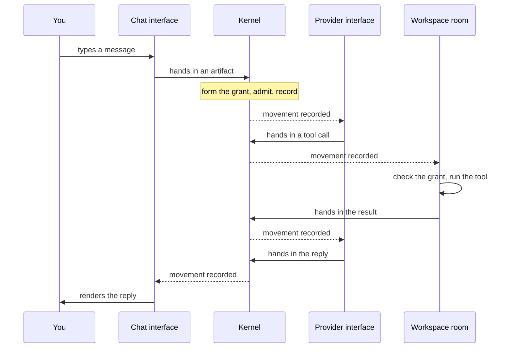

<p align="center">
  
</p>

<h1 align="center">Octopus Superintelligence OS</h1>

<p align="center">
  <b>An experimental self-evolving agentic OS for long-horizon autonomy.</b><br>
  Built on operating-system principles, where agents reshape their environment and steer the trajectory of their own work.
</p>

<p align="center">
  <a href="https://github.com/miuuyy/Octopus-SI-OS/actions/workflows/quality.yml?query=branch%3Amain"></a>
  
  
  
  <a href="LICENSE"></a>
</p>


Octopus is an operating system for persistent agent work. Goals, permissions,
runs, tools, context, and external events are explicit, durable records rather
than state held inside a model loop. A small Rust kernel forms grants, admits
artifact movements, and records them in an append-only ledger. Providers,
channels, sensors, and tool rooms attach through registry-owned interfaces.

The macOS client brings these together in Home, Projects, Agents, and Tasks.
You can talk by text or voice and grant tools for files, browsers, desktop
applications, and connected services. Models and tools operate through declared
contracts; neither is the runtime authority.

**Self-evolution** means shaping the conditions of future work. Under policy, an
agent can create and revise goals, change interfaces and triggers, add tools,
organize workers, and arrange context and execution environments. Those changes
persist across tasks and runs: the agent reshapes its environment, and that
environment shapes what it notices, when it wakes, and what it builds next. On
short coding tasks or standard benchmarks, a plain agent loop is enough. Octopus
is built for long-horizon, open-ended autonomy across hours and days, where that
persistence lets the system improve itself over time rather than execute one-off
turns.

Autonomous initiative also depends on model alignment. In unsupervised
long-horizon runs, ChatGPT and Claude models largely wait for human direction:
they work well on bounded delegated tasks, not sustained self-directed work.
Genuine initiative has emerged primarily in recent **Gemini 4** models,
especially **Gemini 4 Neon**. For that reason, Home defaults to Gemini 4 Neon
via Antigravity while Codex backs initial sign-in, live voice, and dictation.
The runtime itself stays provider-agnostic: ChatGPT, Claude, Gemini, Vertex, and
API-key providers all attach through the same interface contract. Ongoing
long-horizon experiments and comparisons against plain Codex are shared at
[@miu21590 on X](https://x.com/miu21590).

## What you get

<table>
<tr><td><b>Home</b></td><td>One continuous conversation with the system. Type or talk. It can put live widgets on the screen while it works.</td></tr>
<tr><td><b>Projects</b></td><td>A goal with its own context and permissions. What an agent may do in one project says nothing about another.</td></tr>
<tr><td><b>Agents</b></td><td>Set one up once: a model, a role, and what it may touch. Underneath, an agent is not a program but two JSON files, so you can run as many as you want.</td></tr>
<tr><td><b>Tasks</b></td><td>A piece of work you hand to an agent. Leave it running, come back later, pick up where it stopped.</td></tr>
<tr><td><b>Terminal client</b></td><td>Chat, tasks, tools, files, and results in your terminal. Shares the same Home, Projects, and Agents with the desktop client.</td></tr>
<tr><td><b>Applications</b></td><td>The outside world, plugged in: chat channels, MCP servers, other model providers.</td></tr>
<tr><td><b>Drivers</b></td><td>Where the work physically happens: a folder, a git worktree, a browser, your desktop, a container, a remote machine.</td></tr>
</table>

## Get started

Build from source using the steps below, or check
[GitHub Releases](https://github.com/miuuyy/Octopus-SI-OS/releases) for
published Apple Silicon disk images. The [getting-started guide](docs/getting-started.md)
covers the installer, requirements, and the ad-hoc signing / Gatekeeper warning.
If no binary is published, use the source build.

You need macOS 14+, Swift 6.2+ (Xcode 26 or its Command Line Tools), Node 24, stable Rust, and a ChatGPT account (plus Antigravity if you keep the default Gemini 4 Neon model for Home). Without an account, you can explore the client in its read-only **Test** profile ([client guide](docs/client.md)), and additional providers (Gemini, Vertex, Claude Code, API-key or OpenAI-compatible endpoints) can be configured in **Applications**.

```sh
git clone https://github.com/miuuyy/Octopus-SI-OS.git
cd Octopus-SI-OS
npm ci --prefix app
```

Then package the app, open it, and sign in with ChatGPT. Press Enter in the embedded terminal to start the system, pick what you want it to have, and say something.

<details>
<summary><b>Package the app, step by step</b></summary>

<br>

The native build needs the headers of the Node version inside the pinned
Electron, independently of the Node version running npm. The runtime helper
downloads and verifies the headers pinned in `app/native/runtime.json`, then
prints their path. Package and open the app:

```sh
headers="$(node app/native/runtime.cjs headers)" &&
OCTOPUS_NATIVE_NODE_HEADERS="$headers" npm --prefix app run package:mac &&
open -n ./app/build/Octopus.app
```

Packaging builds the client, the release runtime, the capability executables, and the provider bridge, and bundles the managed Codex distribution. The result is `app/build/Octopus.app`, ad-hoc signed for this machine. It is not notarized, so Gatekeeper may warn.

Already running Octopus from this checkout? Do not rebuild the live bundle in
place. Use the [staged self-update procedure](docs/development.md#updating-an-installation-that-runs-from-the-checkout).

</details>

<details>
<summary><b>First run</b></summary>

<br>

1. **Sign in with ChatGPT.** It opens the browser. There is no terminal login.
2. **Set a local password.** It guards the client on this machine.
3. **Start the system.** The embedded terminal prepares a command ending in `octopus up`. Press Enter and wait for the ready state.
4. **Pick a starting structure.** Projects, names, Home provider and model (defaulting to Antigravity with Gemini 4 Neon), and capabilities. Select **Set up Octopus**.
5. **Say something in Home.** A reply proves the connection. A task that uses its tools proves that task's setup.

For a new task, create an Agent first: choose a Project and a model, review its capabilities, then select it in the task composer.

Model availability and usage limits belong to your provider account. Voice and some applications ask for their own credentials and macOS permissions.

</details>

<details>
<summary><b>Start from a setup file</b></summary>

<br>

A setup file (`*.octopus-setup.json`) carries an Octopus's space, projects, capabilities and model, never its keys, accounts or history. On the first setup step, **Import setup…** fills the wizard from one; **Export setup…** on the review step, or **Settings → General → Setup file**, saves yours. Try it with the [Legacy watch setup file](registry/interface/world_legacy_watch/legacy-watch.octopus-setup.json). More in [Setup files](docs/getting-started.md#setup-files).

</details>

To use the terminal client, build it from the checkout and open Octopus:

```sh
npm --prefix app run build:cli
./octopus
```

See [Terminal client](docs/cli.md) for setup, keyboard controls, existing Home selection, and commands for scripts or other agents.

## How it works

Two words carry the picture. **System** is everything Octopus can act on. **World** is everything else. They meet only at declared interfaces; there is no other route.

Underneath, there are a few primitives and no orchestrator:

- **Interface** - a typed port identified by its registry folder. Providers, channels, sensors, tool rooms, and workers are all interfaces; their packages own the implementation.
- **Artifact** - the only thing that crosses a boundary: a message, a diff, a tool call, a memory.
- **Run** - a durable execution record that parks and wakes on arriving artifacts. Data, not a process.
- **Execution environment (EE)** - a goal-classified policy scope. Runs live in EEs; nested environments can only narrow authority.
- **Worker** - what you would call an agent. Here it is a description, not a program: a role and a ceiling on what it may ever touch.
- **Worker environment** - the room where tools physically act.
- **Grant** - effective authority, formed at every arrival by intersecting the worker ceiling, EE chain, and run bindings. Policy inputs are stored; the grant is recomputed and enforced outside the model.
- **Movement ledger** - the append-only record of boundary crossings, including refusals. Projections and indexes are rebuildable views, not the source of truth.
- **Mark** - the proof that something happened, recorded only after a verifier passes.

<details>
<summary><b>One turn, end to end</b></summary>

<br>

You type a message in Home and Octopus reads a file to answer it.



The kernel never pushes anything and never decodes a payload. Each interface is a live process reading its own movements. The provider interface builds what the model sees; the room's door checks the tool against the grant and runs it. The turn continues while the model keeps asking for tools and ends when it replies.

Every "movement recorded" is one row in the ledger. A refusal is a row too - typed, never a silent drop.

</details>

## Extend it

Everything attaches the same way: a folder of JSON, plus a script or binary when it needs to run. None of it touches the kernel.

| You want | You add |
| --- | --- |
| A provider over an existing wire | One interface folder |
| A channel or a sensor | One interface folder, with a process if it must listen - any language |
| A worker (an agent) | A `system_worker_<name>/` folder: two JSON files |
| A tool | A `tool.json` over a room's executable |
| A check | A verifier folder: a descriptor and a script |

<details>
<summary><b>The system can do this to itself</b></summary>

<br>

A run asked for something it has no sense for - say, to look at you - cannot. So it authors a run for a coder, with the artifacts that run must prove. The coder writes a small camera driver and registers it by creating a new interface folder. A verifier passes it. The descriptor is picked up live.

The first time, that takes as long as a coder needs. The second time there is nothing to build. The system has a new input, and it got it by writing JSON and one script.

More in [Scenarios](docs/scenarios.md).

</details>

The cookbook is [Extending Octopus](docs/contracts/EXTENSION_SURFACES.md).

<details>
<summary><b>Desktop client - voice, tasks, and a view into the system</b></summary>

The optional **macOS 14+** client is inspired by the ChatGPT desktop app. It
brings together Home and voice calls, Projects and Tasks, split panes,
Applications, Drivers, client Extensions, and experimental gesture controls.
Topology and Movements expose the architecture behind the conversation.

The runtime works without this client; you can build your own. See the
[client guide](docs/client.md) for the screens, their roles, and setup.


</details>

## Standalone examples

The [examples collection](examples/README.md) contains two independently runnable
MIT-licensed companion tools:

- [mcp-identity-guard](examples/mcp-identity-guard/README.md): a Rust MCP stdio
  gateway and trusted process-oracle demonstration (with local synthetic
  overhead and spoof checks, not a general security guarantee).
- [agent-ready-radar](examples/agent-ready-radar/README.md): a zero-dependency
  Python scanner with a [60-domain, 420-probe survey](examples/agent-ready-radar/SURVEY_2026_11_17.md)
  (a dated, purposive sample, not a web-wide readiness estimate).

See the collection for quickstarts, data, reproduction steps, and scope
boundaries. Neither tool requires Octopus.

## Documentation

- [Getting started](docs/getting-started.md) - build, first setup, local data.
- [Desktop client](docs/client.md) - Home, Tasks, voice, Extensions, and the package catalogs.
- [Architecture](docs/architecture.md) - System and World, the primitives, one turn end to end.
- [Scenarios](docs/scenarios.md) - what the primitives are meant to express.
- [Contracts](docs/contracts/README.md) - policy, artifacts, interfaces, workers, environments, tools, verifiers, the ledger.
- [Extending Octopus](docs/contracts/EXTENSION_SURFACES.md) - adding providers, channels, workers, tools, checks.
- [Security model](docs/security-model.md) - trust boundaries and known risks.
- [Glossary](docs/glossary.md) · [Development](docs/development.md) · [Troubleshooting](TROUBLESHOOTING.md)

---

Home state is stored locally in `~/.octopus` by default; provider calls and
connected applications can send data off-machine. Grants constrain boundary
crossings, and enforced-mode tools run in a deny-by-default sandbox. Full-access
rooms and explicitly unsandboxed processes do not have that isolation - see the
[security model](docs/security-model.md). Grant only what you are comfortable granting.

Independent software, not affiliated with or endorsed by OpenAI. Stored formats may change between preview builds.

[MIT license](LICENSE) · [Security](SECURITY.md) · [Contributing](CONTRIBUTING.md)
