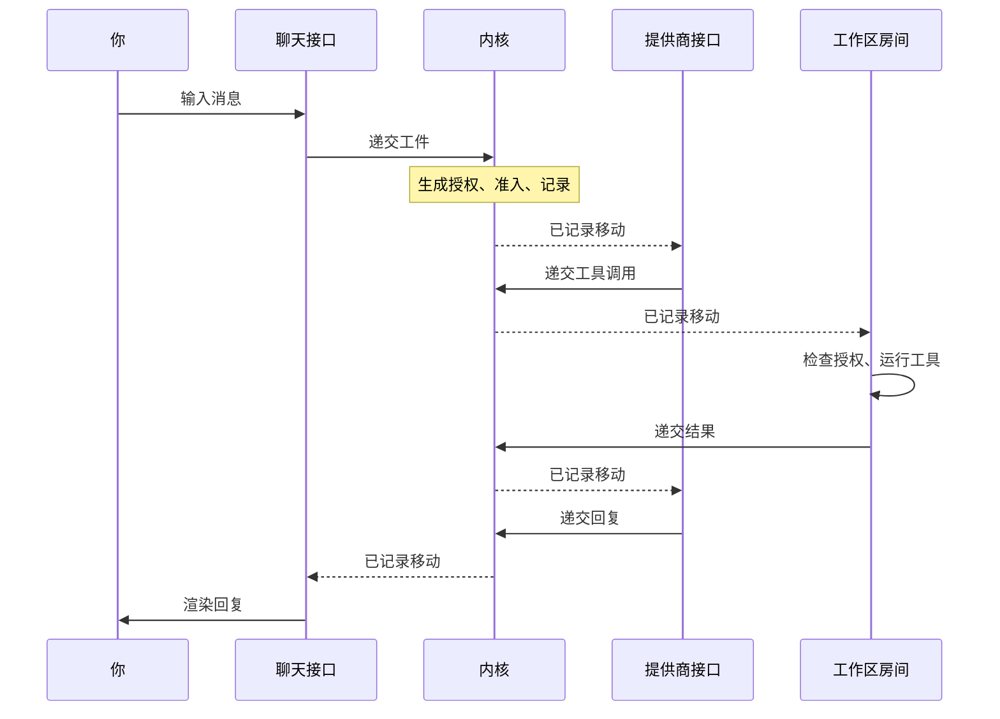

<p align="center">
  
</p>

<h1 align="center">Octopus Superintelligence OS</h1>

<p align="center">
  <b>面向长周期自主运行的实验性自演化智能体操作系统。</b><br>
  基于操作系统原则构建，智能体可重塑自身所处环境，并引导自身工作的演进轨迹。
</p>

<p align="center">
  <a href="https://github.com/miuuyy/Octopus-SI-OS/actions/workflows/quality.yml?query=branch%3Amain"></a>
  
  
  
  <a href="LICENSE"></a>
</p>

<p align="center">
  <a href="README.md">English</a> · <b>简体中文</b> · <a href="README.ja.md">日本語</a>
</p>


Octopus 是一个用于持久化智能体工作的操作系统。目标、权限、运行（run）、工具、上下文以及外部事件都是显式且持久化的记录，而非保存在模型循环内部的状态。一个精简的 Rust 内核负责生成授权（grant）、准入工件移动（artifact movement），并将其记录在仅追加的账本（ledger）中。提供商、渠道、传感器和工具房间均通过注册表拥有的接口接入。

macOS 客户端将这些能力整合到 Home、Projects、Agents 和 Tasks 中。你可以通过文字或语音与其对话，并授予其访问文件、浏览器、桌面应用和已连接服务的工具权限。Home 默认通过 Antigravity 使用 Gemini 4 Neon，同时 Codex 负责初始登录、实时语音和语音听写；ChatGPT、Claude、Gemini、Vertex 以及 API 密钥提供商均以相同方式接入。模型和工具均通过声明式契约运行；两者都不是运行时权威。

**自演化（Self-evolution）** 意味着塑造未来工作的条件。在策略约束下，智能体可以创建和修订目标、更改接口（触发器）、添加工具、组织工作单元（worker），并安排上下文和执行环境。这些变更会跨任务和跨运行持续生效：它们会影响智能体注意到什么、何时行动、处理什么工作，以及接下来能使用哪些能力。智能体改变自身环境，而该环境反过来塑造它随后的行为，从而让系统在长期运行的工作中不断发展并自我改进，而不仅限于单次对话轮次。

> [!NOTE]
> 这是一个研究预览版。对于标准基准测试或普通编程任务，Octopus 并不会比 Codex CLI 这类普通智能体循环提供更多优势。它专为**长周期、开放式自主运行**而构建，智能体会在数小时乃至数天内自行组织目标、触发器和运行。在迄今为止的无人值守运行中，ChatGPT 和 Claude 模型会等待人类指示，无法自主维持主动性；真正的自主主动性目前主要出现在近期的 **Gemini 4** 模型中，尤其是 **Gemini 4 Neon**。当前的活跃实验聚焦于此，同时运行时本身保持提供商无关；持续中的运行记录及与原生 Codex 的对比分享在 [@miu21590 on X](https://x.com/miu21590)。

## 你将获得什么

<table>
<tr><td><b>Home（主页）</b></td><td>与系统的单一连续对话。可打字或语音交流。系统工作时可以在屏幕上放置实时小组件。</td></tr>
<tr><td><b>Projects（项目）</b></td><td>带有独立上下文和权限的目标。智能体在某个项目中被允许做的事，不会对另一个项目产生任何影响。</td></tr>
<tr><td><b>Agents（智能体）</b></td><td>一次配置即可复用：包含模型、角色以及允许触及的范围。在底层，智能体不是程序，而是两个 JSON 文件，因此你可以按需运行任意多个。</td></tr>
<tr><td><b>Tasks（任务）</b></td><td>交给智能体的一项工作。让它持续运行，稍后回来即可从停下的地方继续。</td></tr>
<tr><td><b>终端客户端</b></td><td>在终端中使用对话、任务、工具、文件和结果。与桌面客户端共享同一个 Home、Projects 和 Agents。</td></tr>
<tr><td><b>Applications（应用）</b></td><td>接入外部世界：聊天渠道、MCP 服务器以及其他模型提供商。</td></tr>
<tr><td><b>Drivers（驱动）</b></td><td>工作实际发生的场所：文件夹、git worktree、浏览器、你的桌面、容器或远程机器。</td></tr>
</table>

## 快速开始

请按以下步骤从源码构建，或前往 [GitHub Releases](https://github.com/miuuyy/Octopus-SI-OS/releases) 查看已发布的 Apple Silicon 磁盘镜像。[入门指南](docs/getting-started.md)详细介绍了安装程序、环境要求以及临时签名（ad-hoc signing）/ Gatekeeper 警告。如果尚未发布预编译二进制包，请使用源码构建。

你需要 macOS 14+、Swift 6.2+（Xcode 26 或其 Command Line Tools）、Node 24、稳定版 Rust 以及一个 ChatGPT 账号（如果 Home 保持默认的 Gemini 4 Neon 模型，还需要 Antigravity）。没有账号时，你可以在只读的 **Test** 配置文件中体验客户端（见[客户端指南](docs/client.md)），其他提供商（Gemini、Vertex、Claude Code、API 密钥或兼容 OpenAI 的端点）均可在 **Applications** 中配置。

```sh
git clone https://github.com/miuuyy/Octopus-SI-OS.git
cd Octopus-SI-OS
npm ci --prefix app
```

随后打包应用、打开它并使用 ChatGPT 登录。在内置终端中按回车启动系统，选择你希望授予它的能力，然后随便说点什么即可开始。

<details>
<summary><b>分步打包应用</b></summary>

<br>

原生构建需要所固定 Electron 版本内部 Node 版本的头文件，且独立于当前运行 npm 的 Node 版本。运行时辅助脚本会下载并校验 `app/native/runtime.json` 中固定的头文件，然后输出其路径。打包并打开应用：

```sh
headers="$(node app/native/runtime.cjs headers)" &&
OCTOPUS_NATIVE_NODE_HEADERS="$headers" npm --prefix app run package:mac &&
open -n ./app/build/Octopus.app
```

打包过程会构建客户端、发布版运行时、能力可执行文件以及提供商桥接器，并内置受管的 Codex 分发包。输出产物为 `app/build/Octopus.app`，针对本机进行了临时签名（ad-hoc signed）。由于未经公证（notarized），Gatekeeper 可能会弹出警告。

如果你已经从此代码检出目录运行着 Octopus，请勿原地重新构建正在运行的应用包。请使用[分阶段自更新流程](docs/development.md#updating-an-installation-that-runs-from-the-checkout)。

</details>

<details>
<summary><b>首次运行</b></summary>

<br>

1. **使用 ChatGPT 登录。** 这会打开浏览器。没有终端登录方式。
2. **设置本地密码。** 它用于保护本机上的客户端。
3. **启动系统。** 内置终端会准备好一条以 `octopus up` 结尾的命令。按回车并等待进入就绪状态。
4. **选择初始结构。** 设置项目、名称、Home 提供商和模型（默认为 Antigravity 的 Gemini 4 Neon）以及能力。选择 **Set up Octopus**。
5. **在 Home 中说点什么。** 收到回复即证明连接正常。运行一个使用其工具的任务即可验证该任务的配置是否正常。

要创建新任务，请先创建一个 Agent：选择一个 Project 和一个模型，确认其能力，然后在任务输入框中选择它。

模型可用性与使用额度取决于你的提供商账号。语音和部分应用会请求各自的凭据和 macOS 系统权限。

</details>

<details>
<summary><b>从配置文件（setup file）启动</b></summary>

<br>

配置文件（`*.octopus-setup.json`）携带 Octopus 的空间、项目、能力和模型配置，但绝不包含密钥、账号或历史记录。在设置向导的第一步，点击 **Import setup…** 即可从配置文件填充向导；在复核步骤点击 **Export setup…**，或进入 **Settings → General → Setup file**，即可保存你自己的配置。可以使用 [Legacy watch 配置文件](registry/interface/world_legacy_watch/legacy-watch.octopus-setup.json)试一试。更多信息见[配置文件说明](docs/getting-started.md#setup-files)。

</details>

要使用终端客户端，请从当前代码检出目录构建并启动 Octopus：

```sh
npm --prefix app run build:cli
./octopus
```

有关安装设置、键盘快捷键、选择现有 Home 以及供脚本或其他智能体使用的命令，请参阅[终端客户端文档](docs/cli.md)。

## 工作原理

两个词即可概括整体图景。**系统（System）** 是 Octopus 可以作用的一切。**世界（World）** 是除此之外的一切。两者仅在声明的接口处交汇；不存在其他路径。

在底层，只有少量原语，没有编排器（orchestrator）：

- **接口（Interface）** — 由其注册表目录标识的带类型端口。提供商、渠道、传感器、工具房间和工作单元（worker）全都是接口；各自的包拥有具体实现。
- **工件（Artifact）** — 唯一能跨越边界的东西：一条消息、一个 diff、一次工具调用、一条记忆。
- **运行（Run）** — 持久化的执行记录，在工件到达时唤醒，否则挂起等待。它是数据，而不是进程。
- **执行环境（EE，Execution environment）** — 按目标分类的策略作用域。运行存在于执行环境中；嵌套环境只能收窄权限。
- **工作单元（Worker）** — 也就是你通常所说的智能体（agent）。在这里它是一份描述而非程序：包含一个角色以及它永远不可逾越的权限上限。
- **工作单元环境（Worker environment）** — 工具实际发生物理作用的房间。
- **授权（Grant）** — 实际生效的权限，在每次到达时通过对工作单元上限、执行环境链和运行绑定求交集生成。策略输入会被存储；授权在模型外部重新计算并强制执行。
- **移动账本（Movement ledger）** — 仅追加的边界跨越记录，拒绝（refusal）同样会被记录。投影和索引只是可重建的视图，而非真实来源。
- **标记（Mark）** — 某件事确实发生过的证明，仅在校验器（verifier）通过后才会记录。

<details>
<summary><b>端到端的单轮交互</b></summary>

<br>

你在 Home 中输入一条消息，Octopus 读取一个文件来回答它。



内核从不主动推送任何内容，也从不解码载荷。每个接口都是一个持续运行的进程，各自读取属于自己的移动记录。提供商接口构造模型可见的上下文；房间的门（door）对照授权检查工具并执行它。只要模型继续请求工具，这一轮就会持续下去，直到它给出回复时结束。

每一次“已记录移动”都是账本中的一行。拒绝同样是一行——带有明确类型，绝不会静默丢弃。

</details>

## 扩展系统

所有能力都以同一种方式接入：一个包含 JSON 的文件夹，需要执行逻辑时再附带一个脚本或二进制文件。全都不需要改动内核。

| 你想要 | 你需要添加 |
| --- | --- |
| 基于现有协议的提供商 | 一个接口文件夹 |
| 一个渠道或传感器 | 一个接口文件夹；若需要监听则附带一个进程——任意语言均可 |
| 一个工作单元（智能体） | 一个 `system_worker_<name>/` 文件夹：两个 JSON 文件 |
| 一个工具 | 位于房间可执行程序之上的一个 `tool.json` |
| 一项检查 | 一个校验器（verifier）文件夹：一个描述符和一个脚本 |

<details>
<summary><b>系统可以对自身完成这一切</b></summary>

<br>

当某次运行被要求做一件它缺乏对应感知能力的事——比如看看你——它无法直接做到。于是它会为编程工作单元（coder）编排一次运行，并写明该运行必须证明的工件。编程工作单元编写一个小型摄像头驱动，并通过创建新的接口文件夹将其注册。校验器验证通过后，描述符会被实时加载。

第一次这么做需要花费编程工作单元编写的时间。第二次就无需再构建任何东西了。系统拥有了新的输入能力，而它获得该能力的方式仅仅是写下 JSON 和一个脚本。

更多内容见[场景说明](docs/scenarios.md)。

</details>

详细操作指南请见[扩展 Octopus](docs/contracts/EXTENSION_SURFACES.md)。

<details>
<summary><b>桌面客户端 — 语音、任务以及洞察系统内部</b></summary>

可选的 **macOS 14+** 客户端灵感来自 ChatGPT 桌面应用。它整合了 Home 与语音通话、Projects 与 Tasks、分屏窗格、Applications、Drivers、客户端 Extensions 以及实验性手势控制。Topology 和 Movements 视图则将对话背后的系统架构呈现出来。

运行时不依赖此客户端也能工作；你可以自行构建客户端。各界面说明、角色与设置方式请参阅[客户端指南](docs/client.md)。


</details>

## 独立示例

[示例集合](examples/README.md)包含两个可独立运行的 MIT 协议配套工具：

- [mcp-identity-guard](examples/mcp-identity-guard/README.md)：一个 Rust 编写的 MCP stdio 网关与受信任进程预言机（process-oracle）演示（包含本地合成开销与伪造检查，并非通用安全保证）。
- [agent-ready-radar](examples/agent-ready-radar/README.md)：一个零依赖的 Python 扫描器，附带一份[覆盖 60 个域名、420 次探测的调查报告](examples/agent-ready-radar/SURVEY_2026_11_17.md)（带有日期的定向样本，并非全网就绪度估算）。

快速开始、数据、复现步骤及范围边界请参见示例集合。这两个工具均不依赖 Octopus。

## 文档

- [入门指南](docs/getting-started.md) — 构建、首次设置、本地数据。
- [桌面客户端](docs/client.md) — Home、Tasks、语音、Extensions 以及包目录。
- [架构](docs/architecture.md) — 系统与世界、核心原语、端到端单轮流程。
- [场景](docs/scenarios.md) — 这些原语旨在表达的使用场景。
- [契约](docs/contracts/README.md) — 策略、工件、接口、工作单元、环境、工具、校验器、账本。
- [扩展 Octopus](docs/contracts/EXTENSION_SURFACES.md) — 添加提供商、渠道、工作单元、工具和检查。
- [安全模型](docs/security-model.md) — 信任边界与已知风险。
- [术语表](docs/glossary.md) · [开发指南](docs/development.md) · [故障排查](TROUBLESHOOTING.md)

---

Home 状态默认存储在本地 `~/.octopus` 目录中；提供商调用和已连接的应用可能会将数据发送到本机之外。授权约束边界跨越，强制模式（enforced-mode）工具运行在默认拒绝（deny-by-default）的沙箱中。完全访问房间（full-access room）和显式非沙箱进程不具备这种隔离——请参阅[安全模型](docs/security-model.md)。请仅授予你放心的权限。

独立软件，与 OpenAI 无关联，亦未获得其背书。存储格式在预览版本之间可能会发生变化。

[MIT 许可证](LICENSE) · [安全说明](SECURITY.md) · [贡献指南](CONTRIBUTING.md)
